# SMTP Traffic Analysis: Detecting Phishing and Malware Delivery

A packet-level investigation of email traffic using **Wireshark**. I analyzed a PCAP file containing SMTP traffic to see how mail servers rejected suspicious messages, and to identify an attachment that looks like malware delivery.


> **Full write-up:** [Word document](docs/SMTP_Phishing_Analysis_Project.docx) | [PDF version](docs/SMTP_Phishing_Analysis_Project.pdf)

---

## Project at a glance

| | |
|---|---|
| **Objective** | Investigate captured SMTP traffic to identify blocked mail, security rejections, and suspicious attachments |
| **Tool** | Wireshark (display filters, packet details, Internet Message Format view) |
| **Data** | `traffic.pcap`: 1,637 packets in total, 512 of them SMTP (captured 19 Dec 2018) |
| **Techniques** | SMTP status-code filtering, packet inspection, header analysis, attachment and encoding review |

## Summary of findings

| # | Question | Filter / method | Answer |
|---|----------|-----------------|--------|
| 1 | Packets containing SMTP response 220 (Service ready) | `smtp.response.code == 220` | **19** |
| 2 | Response code for the email blocked by spamhaus.org | `smtp.response.code == 553` | **553** |
| 3 | Full response message for that packet | Packet details, SMTP layer | **Requested action not taken: mailbox name not allowed (553)** |
| 4 | Messages blocked for presenting a potential security issue | `smtp.response.code == 552` | **6** |
| 5 | SMTP packets available for analysis | `smtp` | **512** |
| 6 | Attachment name in packet 270 | Packet 270, packet details | **document.zip** |
| 7 | Host IP not responding in packet 270 | Packet 270, message body | **212.253.25.152** |
| 8 | Email client used to send the message with `attachment.scr` | `imf contains "attachment.scr"` | **Microsoft Outlook Express 6.00.2600.0000** |
| 9 | Encoding of the suspicious attachment | Packet 685, MIME headers | **base64** |

---

## Walkthrough

### Step 1: Baseline the server greetings (220)
SMTP servers open a session with a `220 Service ready` response. Filtering on it returned **19 packets** (about 1.2% of the capture).

`smtp.response.code == 220`

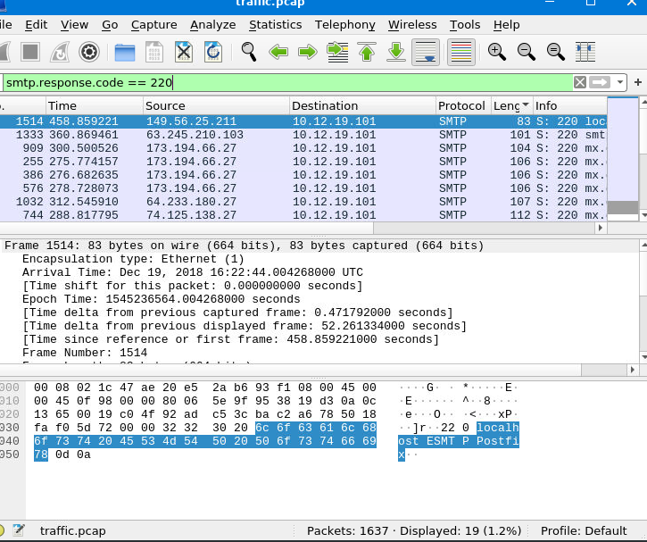

### Step 2: Identify the message blocked by Spamhaus (553)
One response stated the email was blocked using spamhaus.org, a well-known spam blocklist. Filtering on `553` isolated packet 156, whose full response reads **Requested action not taken: mailbox name not allowed (553)**.

`smtp.response.code == 553`

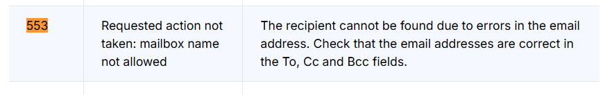
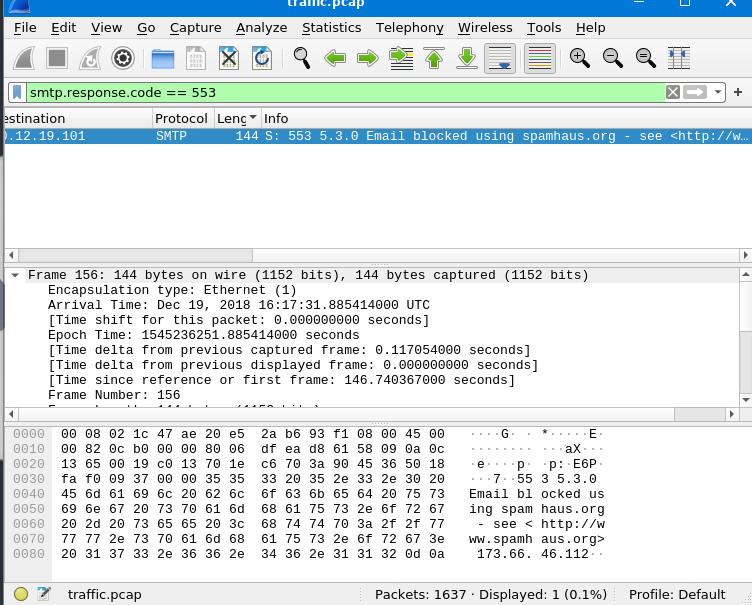
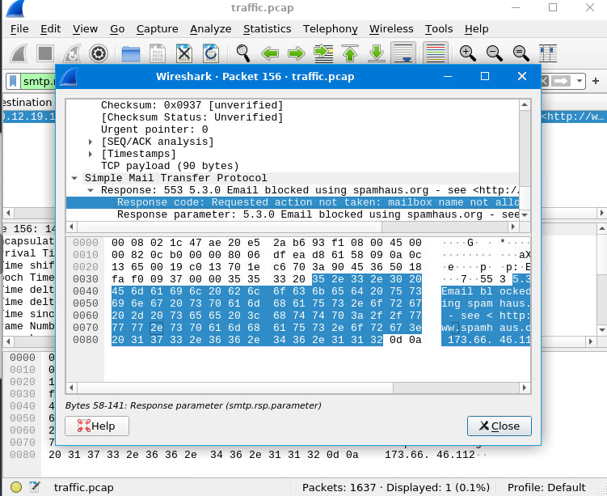

### Step 3: Count messages blocked for security reasons (552)
These responses say the message was blocked because its content presents a potential security issue, so the server rejected the content itself, not just the sender. **6 messages** were blocked.

`smtp.response.code == 552`

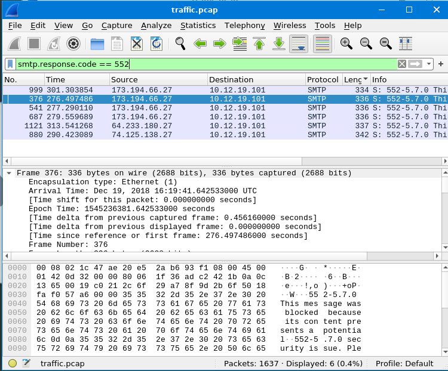

### Step 4: Size the SMTP dataset
The plain `smtp` filter shows **512 SMTP packets**, roughly 31.3% of all traffic in the capture.

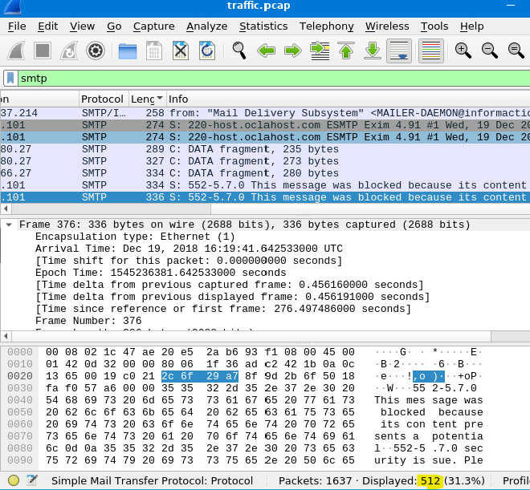

### Step 5: Inspect packet 270 (attachment and undeliverable host)
Packet 270 is a delivery report. Its MIME part is a base64-encoded attachment named **document.zip**, and its body says the message could not be delivered because host **212.253.25.152** is not responding.

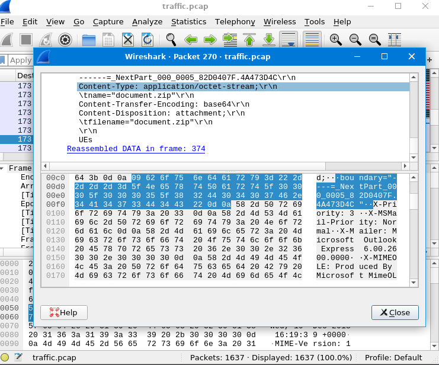
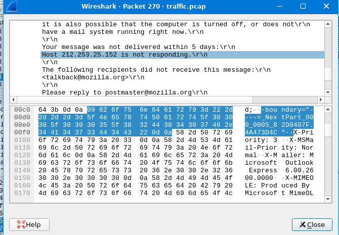

### Step 6: Analyze the suspicious `attachment.scr`
A `.scr` file is a Windows screensaver, which is really an executable, so it is a common way to disguise malware. Searching with the Internet Message Format filter found one message (packet 685): a "RETURNED MAIL: DATA FORMAT ERROR" email made to look like a mail-system bounce.

`imf contains "attachment.scr"`

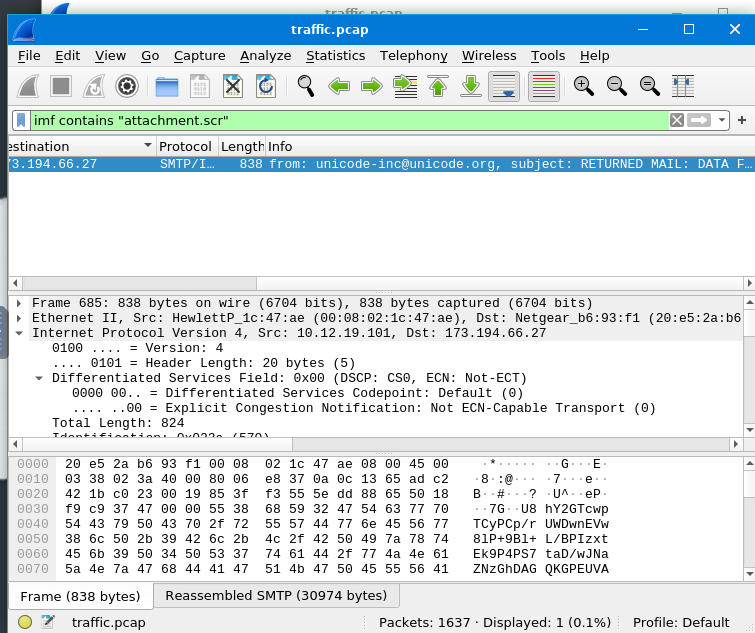

The `X-Mailer` header shows it was sent with **Microsoft Outlook Express 6.00.2600.0000**, a legacy client that is long out of support.

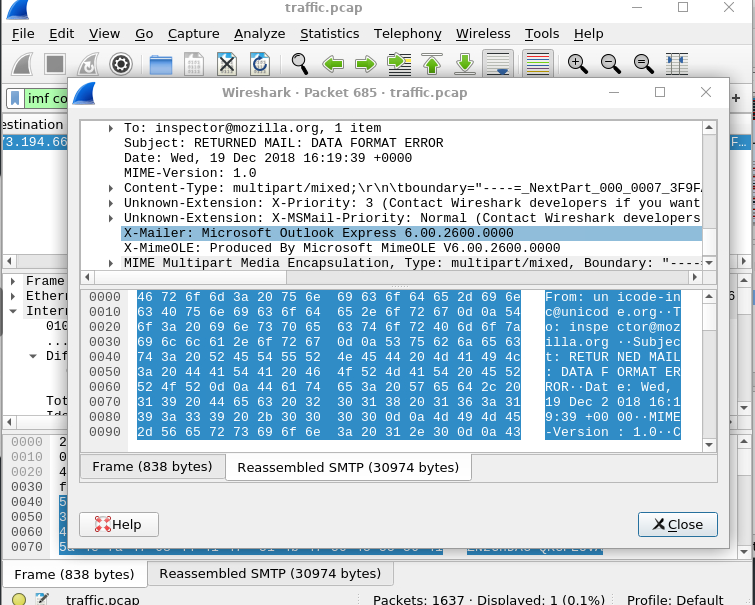

The attachment declares `Content-Transfer-Encoding: base64`, which converts binary content to text so it can travel through SMTP.

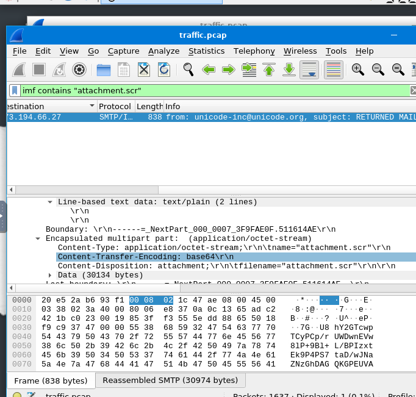

> The suspicious attachment was identified from message metadata only. Its contents were not extracted or executed.

---

## Key takeaways

- **Status codes tell a story.** A 553 pointed to a blocklist decision, while 552 showed content-based rejection: two different defensive layers.
- **Attachments deserve scrutiny.** A zip archive and a `.scr` executable both appeared as base64 attachments, and neither is a format most legitimate email needs.
- **Bounce messages can be lures.** A "RETURNED MAIL" message carrying an executable attachment is a pattern worth flagging.
- **Header details add context.** The `X-Mailer` value exposed an outdated mail client, a useful clue when profiling a sender.

## Defensive recommendations

- Block or quarantine executable attachment types (`.scr`, `.exe`, `.js`, `.vbs`) at the mail gateway.
- Use sandbox detonation for archives and unknown file types before delivery.
- Subscribe to reputation blocklists such as Spamhaus to reject known-bad senders early.
- Enforce SPF, DKIM and DMARC so spoofed bounce messages are easier to detect.
- Alert on unexpected bounce or "returned mail" messages that include attachments.

## Skills demonstrated

- Network traffic analysis with Wireshark display filters
- SMTP protocol knowledge and status-code interpretation
- Email header and MIME structure analysis
- Recognizing phishing and malware-delivery indicators
- Clear technical documentation of an investigation

## References

- [MailerSend: SMTP response codes reference](https://www.mailersend.com/blog/smtp-codes)
- Wireshark documentation: SMTP and Internet Message Format display filters

---

## Repository structure

```
smtp-traffic-analysis-wireshark/
├── README.md
├── docs/
│   ├── SMTP_Phishing_Analysis_Project.docx
│   └── SMTP_Phishing_Analysis_Project.pdf
└── images/
    └── (11 Wireshark screenshots)
```

## About me

(https://www.linkedin.com/in/alex-sosa-salazar/)
